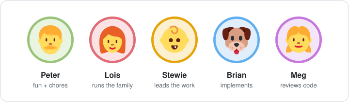
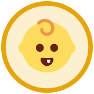
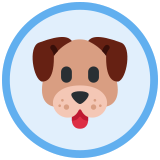
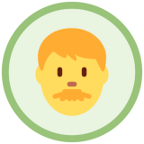
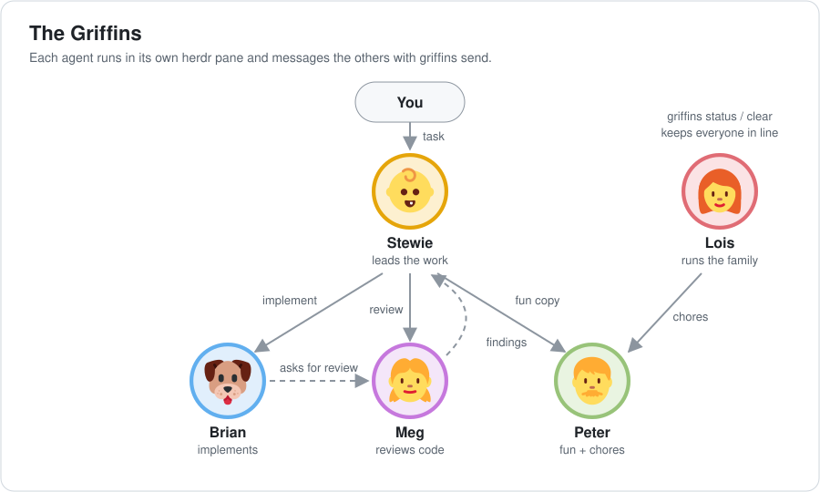

# ai-orchestration

<p align="center"></p>

The Griffins: a fixed family of AI coding agents that work together in [herdr](https://herdr.dev) panes.

## Why Family Guy?

Each agent is named after a member of the Griffin family from the animated sitcom *Family Guy*,
and its job matches the character's personality, so who does what is easy to remember:

- **Stewie** is the evil-genius baby, so he does the hardest thinking and leads the work.
- **Brian** is the well-read, dependable (and slightly pretentious) dog, so he implements.
- **Lois** is the mom who keeps the house running, so she manages the other agents.
- **Peter** is the lovable goofball dad, so he writes stories and fun copy and does the chores Lois gives him.
- **Meg** is the daughter nobody listens to, so she reviews code, the job whose findings everyone wants to ignore.

| | Agent | Role | Runs on |
|---|---|---|---|
|  | lois | runs the family: agent state, clearing screens, chores | Claude (Sonnet) |
|  | stewie | leads the work: architecture, hard problems, planning | Claude (Opus) |
|  | brian | implementation | Claude (Opus) |
|  | peter | stories, fun copy, chores from lois | Claude (Haiku) |
|  | meg | code review only | GitHub Copilot CLI |

## How they work together

<p align="center"></p>

Each agent runs in its own herdr pane and messages the others with `griffins send <name> "<message>"`.
You talk to stewie; he splits the work, and the reports come back to him as messages.

## Layout

- `bin/griffins` - the launcher: starts the family in herdr, and `send`, `status`, `clear`, `move` (see `griffins --help`).
- `agents/<name>.md` - each agent's command, status line, spinner and persona.
- `family.md` - the note every agent gets, with a section per role.
- `settings.json` - Claude settings shared by all agents.
- `assets/` - the images in this README.
- `state/` - runtime state (ignored).

## Setup

```bash
git clone git@github.com:eddpascoal/ai-orchestration.git ~/family
ln -s ~/family/bin/griffins ~/.local/bin/griffins
npm i -g @github/copilot          # for meg
herdr integration install claude
herdr integration install copilot
griffins ~/code/<repo>            # start the family in the herdr TUI
```

Sidebar colours, icons and the working animation live in `~/.config/herdr/`
(`config.toml`, `tag-spaces.sh`, `working-spinner.py`) and are not part of this repo.

## Moving to a new project

**The family works on one project at a time.** All five agents share one working folder (the
repo's checkout), so they see the same branch and files, and the herdr space is named after it.
To point them at another repo, move the whole family:

```bash
griffins move ~/code/<other-repo>
```

What happens:

1. Each agent that is **idle or done** exits and restarts in the new folder with a **fresh
   conversation**. What it knew about the old project is not carried over.
2. An agent that is still **working** or waiting on you is skipped. Let it finish (check with
   `griffins status`), then run the same `griffins move` again to bring it along.
3. The first time an agent sees a folder, Claude (or Copilot, for meg) asks whether to trust it.
   Answer yes in each pane.
4. The herdr space is renamed to the new repo.

Before you move:

- Let the current work finish and get it committed or pushed. Moving doesn't touch the files, but
  the agents forget what they were doing.
- Don't switch branches in the shared checkout while agents are working in it.

If a task needs a second repo alongside the main one, list both; the first is the project and the
others are added with `--add-dir`:

```bash
griffins move ~/code/<repo> ~/code/<shared-lib>
```

To bring a single agent back to an earlier conversation (after a crash or restart), run this in its
pane: `griffins --agent <name> tui --resume <session-id>`.

---

*The agents are named after the Griffin family from Family Guy (© 20th Television); this project
has no connection to the show and uses none of its artwork. The avatars are drawn from
[Twemoji](https://github.com/jdecked/twemoji) by Twitter, Inc. and other contributors, licensed under
[CC-BY 4.0](https://creativecommons.org/licenses/by/4.0/).*
